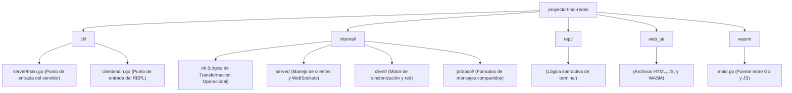
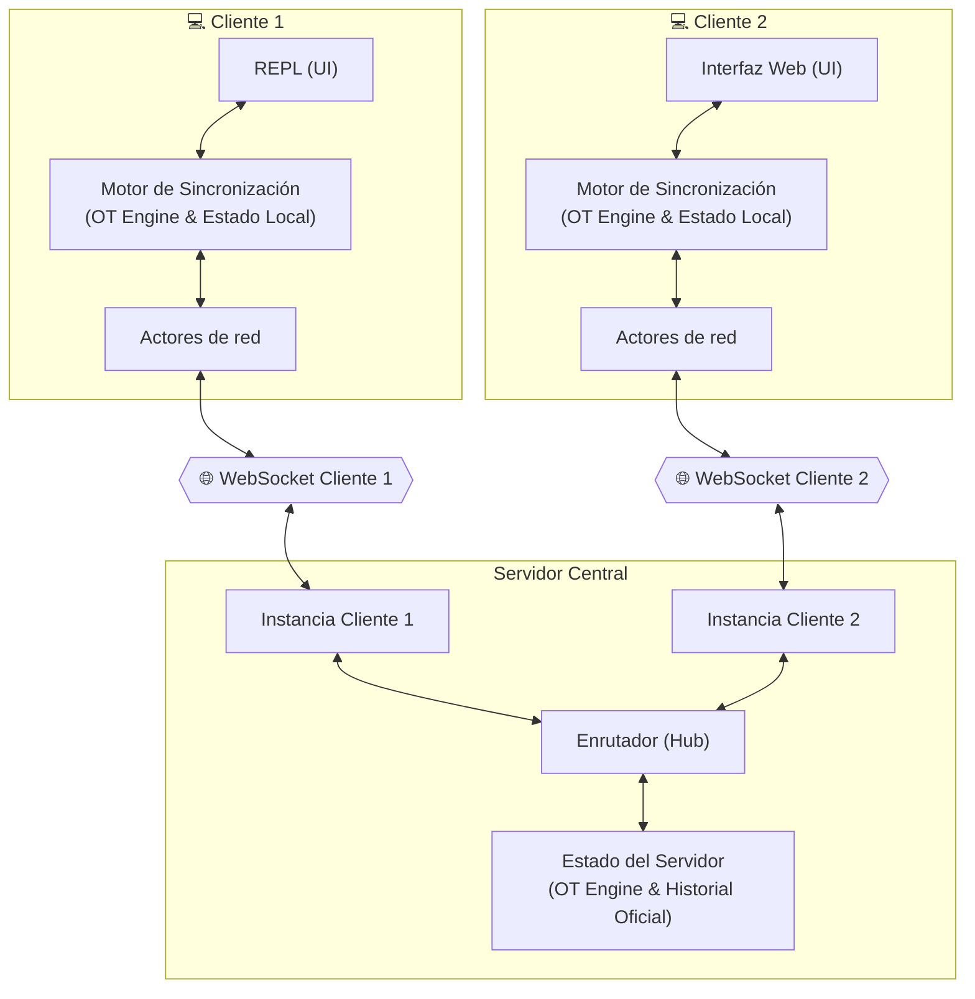
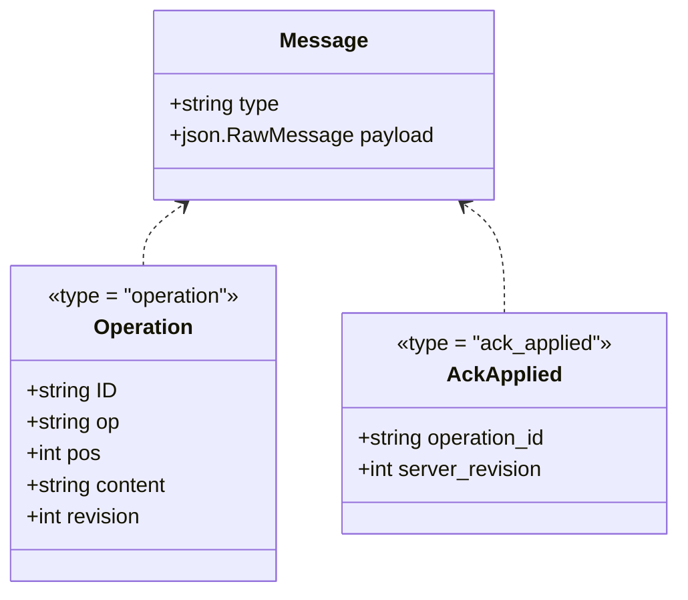
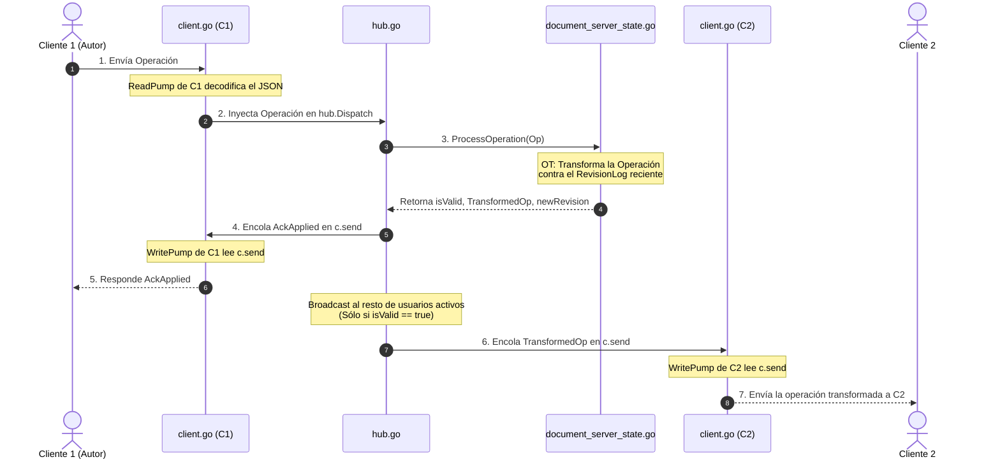
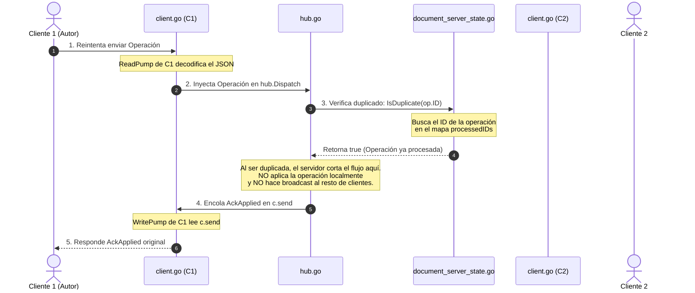
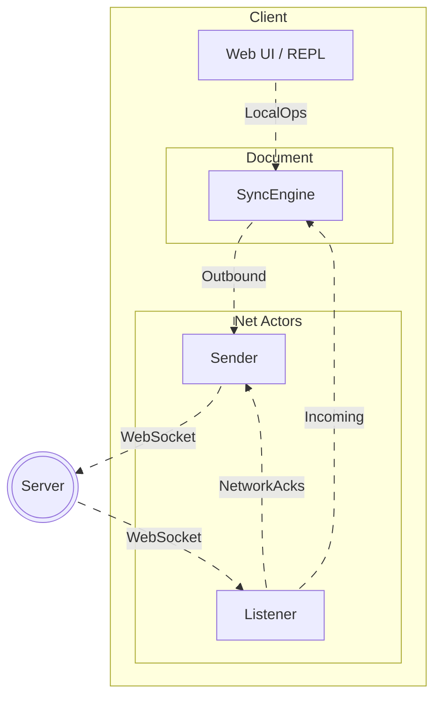
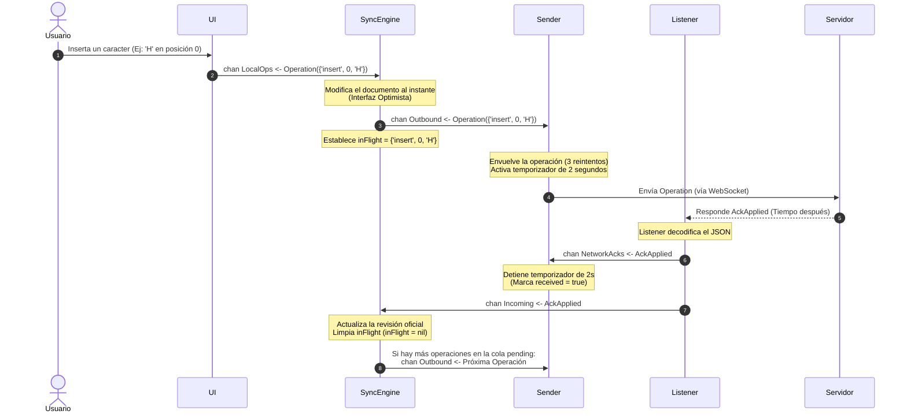
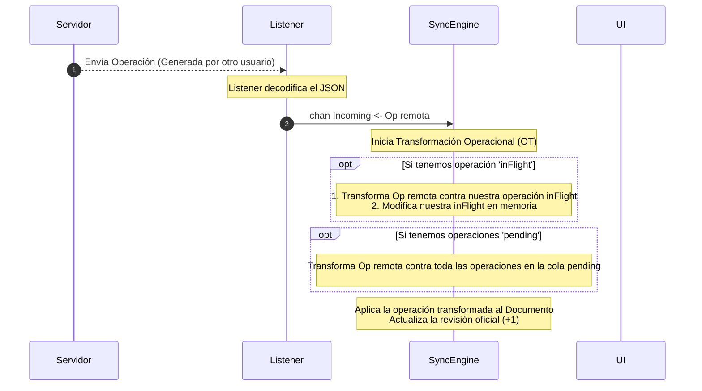

# Estructura del Proyecto

El código está estructurado siguiendo las convenciones típicas de Go, separando responsabilidades:

- `/bin/`: Contiene los ejecutables compilados del servidor y cliente.
- `/cli/`: Contiene los puntos de entrada para los comandos de terminal (`client` y `server`) implementados con Cobra.
- `/internal/`: Lógica central del sistema, que no debe ser expuesta como librería externa.
  - `ot/`: Contiene el corazón matemático del sistema: el algoritmo de Operational Transformation (OT).
  - `client/`: Manejo de la lógica del cliente (motor de sincronización `SyncEngine`, conexión de red, cliente de aplicación).
  - `server/`: Manejo de las conexiones WebSocket (`hub.go`), estado de cada cliente (`client.go`) y el estado autoritativo del documento en el servidor (`document_server_state.go`).
  - `protocol/`: Definición de los mensajes intercambiados (`Message`, `Operation`, `AckApplied`, etc.) y el formato JSON subyacente.
- `/repl/`: Implementación del cliente interactivo de terminal (REPL) con autocompletado y manejo de comandos asíncronos mediante `readline`.
- `/wasm/`: Código en Go diseñado exclusivamente para compilar a WebAssembly. Expone la lógica de sincronización de `internal/client` a JavaScript.
- `/web_ui/`: Archivos estáticos del cliente web (`index.html`, `wasm_exec.js`, `main.wasm`).
- `run.sh`, `load_toxics.py` y `toxiproxy.json`: Scripts y configuración de orquestación para iniciar el sistema (servidor, clientes web/CLI) y configurar un entorno de red adverso (latencia, fallos) localmente.



# Tecnologías Utilizadas

### 1. Go (Golang)
Tanto el backend (servidor WebSocket) como la lógica del cliente están escritos en Go. 
- **Cómo se usa**: En el servidor, maneja concurrencia usando *goroutines* y *channels* de forma masiva (ej. un channel `Dispatch` en el `Hub` y goroutines de `readPump`/`writePump` por cada cliente). En el cliente, gestiona el estado local del documento y el encolado de operaciones asíncronas.

### 2. WebSockets (gorilla/websocket)
- **Cómo se usa**: Provee la conexión persistente, bidireccional y de baja latencia necesaria para un editor en tiempo real. 
- **Explicación Técnica**: A diferencia del HTTP tradicional que es "Request-Response", WebSockets mantiene un socket TCP abierto. Esto permite al servidor enviar (broadcast) los cambios de otros usuarios hacia el cliente en cuanto suceden.

### 3. WebAssembly (WASM)
- **Cómo se usa**: El cliente del navegador carga `main.wasm` (el código de Go compilado). La lógica compleja de OT y sincronización se ejecuta nativamente a gran velocidad en el navegador, exponiendo funciones al frontend (ej. `insertWasm`, `deleteWasm`, y un loop que inyecta estado a `updateState` de JS).
- **Explicación Técnica**: Permite compartir el **mismo código** de sincronización de Go (`internal/client`) entre una aplicación de terminal (CLI) y un cliente Web, evitando reescribir la lógica en JavaScript.

### 4. HTML/JavaScript/TailwindCSS (Frontend)
- **Cómo se usa**: Una interfaz web (UI) simple alojada en `index.html`. Intercepta los eventos de teclado (input) sobre un `<textarea>`, calcula un "diff" local de qué caracter fue insertado o borrado, y le delega el procesamiento a la instancia de WebAssembly.

### 5. Toxiproxy y Docker (Simulación de Red)
- **Cómo se usa**: Para probar el comportamiento del algoritmo OT bajo condiciones reales de red, se integra Toxiproxy. El script `run.sh` levanta un contenedor Docker con Toxiproxy y el script de Python `load_toxics.py` inyecta latencias y fallos al proxy de WebSocket. Esto permite observar cómo la sincronización y la transformación operativa resuelven los conflictos cuando los mensajes llegan con delay o desordenados.

# Arquitectura

A diferencia de una aplicación web tradicional —donde el cliente consulta constantemente a un servidor que centraliza la información—, la arquitectura de esta aplicación provee a cada cliente una copia local, completa e independiente del documento. Esto permite que los usuarios apliquen modificaciones de forma instantánea mediante **actualizaciones optimistas**, sin esperar permisos por parte del servidor.

Cada cliente tiene su propio motor de sincronización para transformar las operaciones que recibe de terceros y adaptarlas a su contexto local. Gracias a esta autonomía, los clientes no dependen del servidor para resolver sus conflictos, sino que "saben" cómo integrar los cambios de manera estrictamente local.

Bajo este paradigma, el servidor ya no impone cómo debe verse el texto final en la pantalla del usuario. En su lugar, mantiene el "historial oficial" del documento y actúa como un árbitro de la sincronización. Sus responsabilidades principales se reducen a:

- Recibir las operaciones entrantes de los clientes.
- Asignarles un número de revisión definitivo.
- Emitir estas operaciones al resto de la red (*broadcast*).

La conexión entre un cliente y el servidor se hace a través de WebSockets.



## Mensajes (internal/protocol/message)

Este paquete define el lenguaje común que hablan tanto el cliente como el servidor.

Utilizamos una envoltura ****para facilitar el polimorfismo al momento de serializar y deserializar JSON. En lugar de enviar un JSON con diferentes estructuras impredecibles, el cliente y el servidor siempre intercambian el mismo tipo base: **`Message`**.

#### **1. La estructura base (`Message`)**

Cada mensaje que viaja por la red tiene esta forma básica:

```json
{
	"type": "<tipo_de_mensaje>",
	"payload": { ... }
}
```

#### **2. Tipos**

Dependiendo de la operación, el `payload` se desempaquetará en una de estas estructuras:

- **Operation**: Representa una acción de edición en el texto.
    - `ID`: UUID único para diferenciar esa operación de cualquier otra.
    - `op`: Puede ser de inserción (`"I"`) o borrado (`"D"`).
    - `pos`: La posición en el texto donde ocurre la operación.
    - `content`: El caracter a insertar (sólo se usa si `op` es `"I"`).
    - `revision`: El número de revisión que el cliente le dio en su copia local.
- **AckApplied**: Es la confirmación del servidor informando que la operación ha sido aplicada y procesada con un número de revisión particular.
    - `operation_id`: El ID de la operación recibida. Evita fallas si se envían acks duplicados.
    - `server_revision`: La revisión actual del servidor.



## Transformación operacional (internal/ot)

El archivo **`transformation.go`** contiene el corazón matemático de la edición colaborativa en tiempo real. Implementa el algoritmo de **Operational Transformation (OT)**.

La función `Transform(incomingOp, appliedOp)` toma una operación que acaba de llegar (`incomingOp`) y la compara con una operación que ya se aplicó (`appliedOp`). El algoritmo asume que ambas operaciones parten del mismo documento base y en caso de ser necesario, modifica (transforma) la posición de la operación entrante para que no pise los cambios que ya se hicieron.
**Importante**: La función desplaza las posiciones de a una unidad asumiendo que solo se insertan o se eliminan caracteres.

El archivo `transformation_test.go` contiene pruebas para validar que esta lógica funciona a la perfección.

## Servidor (internal/server)

Implementamos el patrón estándar de concurrencia en Go para manejar conexiones de red persistentes, conocido comúnmente como el patrón "**Hub & Client**". 

### **1. Las partes del servidor**

- **`socket.go` (El portero):** Es el punto de entrada HTTP de la aplicación. Su responsabilidad es recibir las peticiones de conexión entrantes, "actualizarlas" (upgrade) a una conexión WebSocket, leer el parámetro `revision` de la URL, instanciar el struct `Client`, registrar al cliente en el Hub y lanzar las dos goroutines (`ReadPump` y `WritePump`) que mantendrán viva esa conexión.
- **`client.go` (El adaptador de red):** Representa la conexión de un usuario específico. Tiene dos bucles infinitos que corren en hilos separados:
    - **`ReadPump`:** Escucha la red. Cuando recibe una operación del cliente, la decodifica y la empuja hacia el canal `Dispatch` del Hub.
    - **`WritePump`:** Escucha la memoria (el canal `c.send`). Cada vez que el Hub le deja un mensaje en ese canal, este lo serializa a JSON y lo envía por la red hacia el cliente.
- **`hub.go` (El enrutador central):** Es un bucle único (`Run()`) que se ejecuta en un solo hilo. Maneja el estado de las conexiones (quién entra y quién se va) y enruta los mensajes. Al correr en un único hilo, procesa las operaciones secuencialmente (una por una). Si dos usuarios envían operaciones exactamente a la vez, el canal `Dispatch` las pone en fila. Esto elimina problemas de concurrencia.
- **`document_server_state.go` (El historial):** Mantiene la "fuente de la verdad", el archivo `server_history.json` en el disco, el `RevisionLog` en memoria y un mapa `processedIDs` con los IDs de las operaciones aplicadas. 
Cuando el Hub le pide procesar una operación (`ProcessOperation`), este archivo toma la operación, llama a `ot.Transform` para ajustar su posición contra las operaciones recientes del historial y, si es válida, la persiste en el archivo.

### 2. Flujo de una operación

1.  **Recepción:** Cuando un cliente realiza un cambio en su documento, envía esa operación al servidor por el socket. El hilo (`ReadPump`) que escucha esa conexión (`client.go`) recibe el mensaje. 
2.  **Procesamiento Centralizado:** Una vez llegada al servidor, la operación es enviada hacia el enrutador central (`hub.go`). 
El Hub primero verifica que no se trate de una operación duplicada, si no lo es, se la entrega al motor lógico (`document_server_state.go`) que aplica la lógica de la Transformación Operacional (OT) transformándola contra el historial reciente para acomodar su posición. 
Tras ser aplicada y persistida, el Hub le devuelve un `AckApplied` al autor, indicándole que su cambio ya es oficial y le informa el número de revisión que se le dio en el servidor.
3.  **Broadcast a terceros:** Casi en simultáneo con la confirmación al autor, el Hub toma esa operación transformada y se la envía a todos los demás usuarios que estén conectados en ese momento. Al recibirla a través de su propia conexión de red, las pantallas del resto de los clientes se actualizan para reflejar el cambio.

Gráficamente este flujo se ve así:



### 3. Flujo de una operación duplicada

Si el cliente no recibe el `ackApplied` al cabo de un tiempo de espera, reenvía la operación al servidor. La recepción es igual que en el flujo anterior, lo que cambia es el procesamiento en el servidor.

1. **Detección de Duplicado:** Cuando la operación llega al Hub, este revisa el identificador único (`ID`) de la operación y consulta el mapa de operaciones aplicadas (`processedIDs`) dentro de su estado (`document_server_state.go`). 
Al detectar que esa operación ya existe y fue procesada exitosamente en el pasado, el servidor corta el flujo normal. La operación no se envía al motor lógico.
2.  **Respuesta sin broadcast:** Sabiendo que el cliente solo está enviando el duplicado porque nunca recibió la confirmación original, el Hub reconstruye y le devuelve un `AckApplied` al autor utilizando la revisión actual del servidor.

Gráficamente este flujo se ve así:



## Cliente (internal/client)

Todo cliente se compone o incluye un `AppController`, el contrato mínimo para manejar la lógica del cliente, el flujo de datos, y consultas sobre el documento requeridas por el cliente. Está compuesto por un `DocumentInspector`, quien se encarga de manejar los datos del documento y la transformación de operaciones; y el `ConnectionController` quien controla todo lo relacionado a la conexión.

Estos contratos están implementados de la siguiente manera:

- `AppController` por `AppClient`.
- `ConnectionController` por `ConnectionManager`.
- `DocumentInspector` por `SyncEngine`.

En el caso del REPL y el Cliente Web, ambos instancian un `AppClient` con un `ConnectionManager` y un `SyncEngine` , con canales de comunicación entre ellos para el envío y recepción de operaciones sobre el documento. 

El `ConnectionManager` se encarga de las operaciones de conexión y desconexión, pero delega la tarea del envió y recepción de paquetes a otros dos actores: el `Sender` y `Listener`.

Cuando un cliente ejecuta una operación de conexión el `ConnectionManager` intenta establecer la conexión con el servidor y si es exitosa, instancia un `Sender` y `Listener` con la conexión, un canal para que se comuniquen entre ellos, una referencia a sí mismo para que puedan acceder a datos comunes, y los canales de envío y recepción de operaciones hacia el `SyncEngine` respectivamente. Luego, los deja corriendo concurrentemente. Al ejecutarse una operación de desconexión, estos dejan de ejecutarse.

El `SyncEngine` tiene la responsabilidad de realizar las operaciones de transformación sobre el documento, ya sean operaciones locales, fruto de la interacción del usuario con la UI, o remotas, fruto de la edición por parte de otros usuarios conectados al servidor. Este actor tiene la verdad del documento del lado del cliente, pues él es el que lleva el log de operaciones.

### 1. Flujo de datos a través de canales



### 2. Envío y recepción de operaciones

Flujo en el cliente al enviar una operación local al servidor.



Flujo en el cliente al recibir una operación remota desde el servidor.



## REPL (repl/)

Un Read Eval Print Loop (REPL) que funciona como interfaz de usuario interactiva a través de la terminal. Hace uso de AppClient (que implementa AppController) para manejar el documento y las conexiones.

### Estructura

- **`parser.go`** : Aquí se define la lógica para parsear los comados escritos por el usuario. Toma el texto crudo que escribimos en la terminal  (ej: `insert H 0`) y lo limpia, separa el nombre del comando de sus argumentos, y devuelve un struct `Command` ordenado.
- **`handlers.go`** : Tiene un "diccionario" (`map`) que asocia cada comando con su acción correspondiente.
    - Si escribimos `connect`, ejecuta `r.Ctrl.Connect()`.
    - Si escribimos `insert x 2`, arma un paquete de tipo `message.Operation` y lo envia por el canal `r.LocalOps` para que el `SyncEngine` haga el OT.
    - Si escribimos `doc`, le pide al `SyncEngine` el estado de la sincronización y lo imprime.
- **`repl.go`** : ****Es el orquestador principal. Utiliza una librería de terceros (`chzyer/readline`) para manejar el input y dar utilidades (como usar flechitas para ver el historial y autocompletado con Tab).
    
    El REPL corre como un ciclo infinito mostrando un prompt y el estado del cliente (Conectado o Local). Cuando el usuario presiona Enter, parsea el input del usuario,  invoca al handler correspondiente.
    
    Además expone un canal de notificaciones para que los demás actores que componen el cliente puedan mandar notificaciones de eventos a la UI. Esto lo hace corriendo una función concurrente (`r.notificationServer()`) que se encarga de interactuar con `readline` para mostrarsela al usuario adecuadamente.
    

## Web UI (web_ui/)

Es un Cliente Web que se sirve como un archivo HTML a través de un servidor web. La lógica del documento, y las conexiones con el servidor de la aplicación son las mismas escritas en Go. El código de internal/client se compila a WASM (Web Assembly) y el archivo HTML lo pide al servidor web y lo ejecuta en el navegador usando la API de WASM para JS. 

Además define utilidades para poder interactuar con el documento de forma más natural, como escribir y borrar directamente sobre el documento y que luego eso se interprete en forma de operaciones Insert y Delete para ser enviadas al servidor de la aplicación.

<aside>
☝

**Aclaración:** El “servidor de la aplicación” hace referencia al servidor utilizado para sincronizar los documentos entre clientes, mientras que el “servidor web” hace referencia a un servidor independiente que solo se dedica a servir los archivos necesarios para acceder al cliente web desde un navegador.

</aside>

### Estructura

La arquitectura de frontend difiere de una Single Page Application (SPA) tradicional. Toda la carga pesada recae sobre Go compilado (WASM), delegando a JS puramente el manejo del DOM:

1. **Inicialización**: El navegador (JS) carga el binario `main.wasm`. Go levanta internamente el `SyncEngine` y `ConnectionManager`, y expone funciones "bindings" globales a JavaScript (ej. `insertWasm`, `deleteWasm`, `connectWasm`).
2. **Entrada de Usuario**: Cuando el usuario tipea en el `<textarea>`, un event listener en JS intercepta el evento, calcula un *diff* manual (posición y carácter exacto modificado comparado contra el estado anterior) y llama a la función WASM correspondiente para que aplique la mutación matemática del lado de Go.
3. **Procesamiento y Red (Go)**: La instancia de WASM encola esas operaciones localmente (aplicándolas optimísticamente en su memoria) y se encarga de enviarlas por la conexión WebSocket abierta. En paralelo, ejecuta una Goroutine a modo de *Ticker loop* (60 veces por segundo).
4. **Actualización Visual (JS)**: Si el Ticker detecta un cambio (ej. texto modificado por un usuario remoto tras pasar el conflicto OT, o un simple cambio en el estado de conexión), invoca de vuelta a un callback expuesto por JavaScript llamado `updateState`. Esta función en JS serializa el JSON y renderiza los datos actualizando la UI, con un cuidado minucioso en no sobreescribir la posición actual del cursor de tipeo del usuario.
