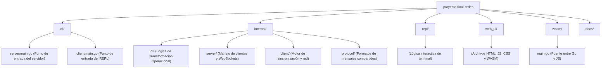

# Proyecto Final de Redes y Sistemas Distribuidos

Implementación de un sistema colaborativo utilizando **Operational Transformation (OT)**, con un servidor central y múltiples clientes soportados tanto desde la terminal (REPL) como desde una interfaz web, con la capacidad de simular problemas de red a través de Toxiproxy.

## 🛠️ Dependencias

Para poder levantar todos los servicios del proyecto es necesario contar con:

- **Go (Golang)**: Para compilar y ejecutar el servidor, el REPL y el módulo WebAssembly.
- **Python 3**: Para servir los archivos de la interfaz web mediante `http.server`.
- **Docker**: Para levantar el contenedor de **Toxiproxy** que simula las condiciones y fallas de la red.

## 🚀 Cómo Correr el Proyecto

### TL;DR 

El proyecto incluye un script orquestador (`run.sh`) que levanta todos los componentes en conjunto. Simplemente ejecutá:

```bash
./run.sh all
```

Esto iniciará en segundo plano (modo silencioso) el **Toxiproxy**, el **Servidor Central** y el **Servidor Web**, y dejará en primer plano el **REPL interactivo** para que comiences a usarlo de forma inmediata. Al presionar `Ctrl+C`, el script se encarga de limpiar y cerrar automáticamente todos los procesos que había levantado.

### Opciones de `run.sh`

El script permite iniciar componentes específicos. Podés pasarle múltiples comandos a la vez.
- **`toxiproxy`**: Inicia el simulador de red en Docker.
- **`server`**: Inicia el servidor central de OT.
- **`web`**: Inicia el servidor estático para el frontend.
- **`repl`**: Inicia el cliente interactivo en la terminal.
- **`all`**: Inicia todos los componentes mencionados.

Podés usar la flag `-q` o `--quiet` al principio para ocultar los logs de los procesos en segundo plano:
```bash
./run.sh -q server web repl
```

### Ejecución Manual (Paso a Paso)

Si preferís levantar cada componente por separado (ideal para debuggear o ver los logs en distintas terminales al mismo tiempo):

1. **Toxiproxy**:
   Levanta el contenedor montando la configuración inicial desde el directorio actual:
   ```bash
   docker run -d --rm --name toxiproxy --network host \
       -v "$(pwd)/toxiproxy.json:/toxiproxy.json" \
       ghcr.io/shopify/toxiproxy -config /toxiproxy.json
   ```

2. **Servidor Central**:
   ```bash
   go run cli/server/main.go start
   ```

3. **Cliente Web**:
   Inicia el servidor HTTP estático en la carpeta de la UI para poder acceder desde el navegador:
   ```bash
   python3 -m http.server 3000 --directory web_ui
   ```

4. **Cliente Terminal (REPL)**:
   ```bash
   go run cli/client/main.go start
   ```

## 🕸️ Interactuando con Toxiproxy vía curl

Toxiproxy expone una API HTTP de administración en el puerto **8474**. Nuestra configuración (`toxiproxy.json`) expone un proxy llamado `redes_proxy` en el puerto `8081` que redirige el tráfico al servidor real (que por defecto corre en `8080`).

Podés ver el estado de todos los proxies activos:
```bash
curl -s localhost:8474/proxies
```

Ver las fallas ("toxics") aplicadas a `redes_proxy`:
```bash
curl -s localhost:8474/proxies/redes_proxy/toxics
```

**Modificar la latencia dinámicamente**:
El proyecto viene configurado de fábrica con un toxic llamado `latencia`. Podés cambiarle el valor (en milisegundos) en tiempo real enviando un POST a la API:
```bash
curl -X POST -H "Content-Type: application/json" \
  -d '{"attributes": {"latency": 1000}}' \
  localhost:8474/proxies/redes_proxy/toxics/latencia
```

**Eliminar la latencia (simular conexión perfecta)**:
```bash
curl -X DELETE localhost:8474/proxies/redes_proxy/toxics/latencia
```

**Volver a agregar la latencia (ej. 2 segundos con 500ms de jitter/variación)**:
```bash
curl -X POST -H "Content-Type: application/json" \
  -d '{"name": "latencia", "type": "latency", "stream": "downstream", "attributes": {"latency": 2000, "jitter": 500}}' \
  localhost:8474/proxies/redes_proxy/toxics
```

## 📁 Estructura del Proyecto

A continuación, un detalle de la arquitectura y la separación de responsabilidades en el repositorio:



- **`cli/`**: Puntos de entrada ejecutables (`main`) para los diferentes binarios del proyecto.
- **`internal/`**: El núcleo del sistema. Aquí reside toda la lógica de negocio (OT), la lógica del servidor (manejo de WebSockets, estado del documento central) y el motor interno del cliente que se encarga de la comunicación y sincronización de estado. Se aísla en esta capa para poder reutilizar este código tanto en el cliente de terminal como en la compilación a WebAssembly.
- **`repl/`**: Contiene exclusivamente la lógica para parsear comandos, renderizar la interfaz y manejar el cliente interactivo en línea de comandos.
- **`wasm/`**: Código específico de Go diseñado para exponer el motor de sincronización (`internal/client`) hacia Javascript a través de WebAssembly en el navegador.
- **`web_ui/`**: Archivos estáticos del frontend que consumen el WASM.
- **`run.sh`**: Script utilitario para orquestar y levantar los entornos rápidamente en desarrollo.
- **`toxiproxy.json`**: Reglas por defecto para inicializar el entorno degradado.
