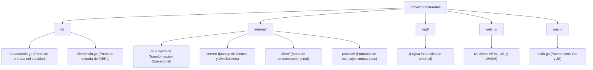
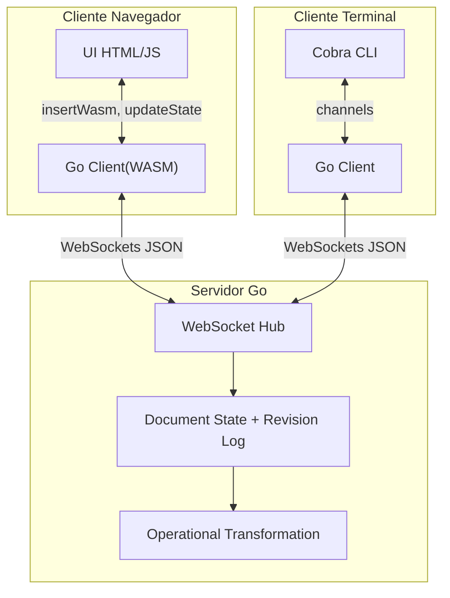
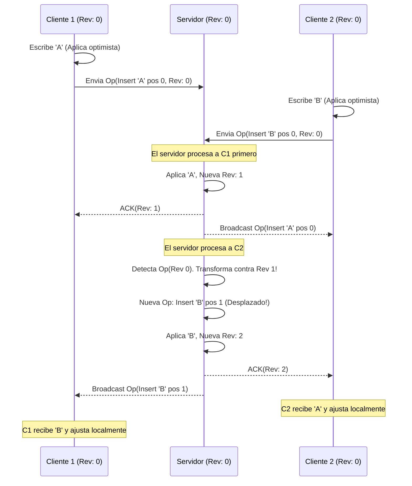

# Documentación del Proyecto: Collaborative Editor

Este proyecto es un editor de texto colaborativo en tiempo real basado en **Operational Transformation (OT)**. Permite a múltiples usuarios editar el mismo documento simultáneamente, resolviendo de manera transparente las colisiones que ocurren por la concurrencia y la latencia de la red.

---

## Estructura del Proyecto

El código está estructurado siguiendo las convenciones típicas de Go, separando responsabilidades:

- `/bin/`: Contiene los ejecutables compilados del servidor y cliente.
- `/cli/`: Contiene los puntos de entrada para los comandos de terminal (`client` y `server`) implementados con Cobra.
- `/internal/`: Lógica central del sistema, que no debe ser expuesta como librería externa.
  - `ot/`: Contiene el corazón matemático del sistema: el algoritmo de Operational Transformation (OT).
  - `client/`: Manejo de la lógica del cliente (motor de sincronización `SyncEngine`, conexión de red, cliente de aplicación).
  - `server/`: Manejo de las conexiones WebSocket (`hub.go`), estado de cada cliente (`client.go`) y el estado autoritativo del documento en el servidor (`document_server_state.go`).
  - `protocol/`: Definición de los mensajes intercambiados (`Message`, `Operation`, `AckApplied`, etc.) y el formato JSON subyacente.
- `/repl/`: Implementación del cliente interactivo de terminal (REPL) con autocompletado y manejo de comandos asíncronos mediante `readline`.
- `/wasm/`: Código en Go diseñado exclusivamente para compilar a WebAssembly. Expone la lógica de sincronización de `internal/client` a JavaScript.
- `/web_ui/`: Archivos estáticos del cliente web (`index.html`, `wasm_exec.js`, `main.wasm`).
- `run.sh`, `load_toxics.py` y `toxiproxy.json`: Scripts y configuración de orquestación para iniciar el sistema (servidor, clientes web/CLI) y configurar un entorno de red adverso (latencia, fallos) localmente.

---

## Tecnologías Utilizadas

### 1. Go (Golang)
Tanto el backend (servidor WebSocket) como la lógica del cliente están escritos en Go. 
- **Cómo se usa**: En el servidor, maneja concurrencia usando *goroutines* y *channels* de forma masiva (ej. un channel `Dispatch` en el `Hub` y goroutines de `readPump`/`writePump` por cada cliente). En el cliente, gestiona el estado local del documento y el encolado de operaciones asíncronas.

### 2. WebSockets (gorilla/websocket)
- **Cómo se usa**: Provee la conexión persistente, bidireccional y de baja latencia necesaria para un editor en tiempo real. 
- **Explicación Técnica**: A diferencia del HTTP tradicional que es "Request-Response", WebSockets mantiene un socket TCP abierto. Esto permite al servidor enviar (broadcast) los cambios de otros usuarios hacia el cliente en cuanto suceden.

### 3. WebAssembly (WASM)
- **Cómo se usa**: El cliente del navegador carga `main.wasm` (el código de Go compilado). La lógica compleja de OT y sincronización se ejecuta nativamente a gran velocidad en el navegador, exponiendo funciones al frontend (ej. `insertWasm`, `deleteWasm`, y un loop que inyecta estado a `updateState` de JS).
- **Explicación Técnica**: Permite compartir el **mismo código** de sincronización de Go (`internal/client`) entre una aplicación de terminal (CLI) y un cliente Web, evitando reescribir la lógica en JavaScript.

### 4. HTML/JavaScript/TailwindCSS (Frontend)
- **Cómo se usa**: Una interfaz web (UI) simple alojada en `index.html`. Intercepta los eventos de teclado (input) sobre un `<textarea>`, calcula un "diff" local de qué caracter fue insertado o borrado, y le delega el procesamiento a la instancia de WebAssembly.

### 5. Toxiproxy y Docker (Simulación de Red)
- **Cómo se usa**: Para probar el comportamiento del algoritmo OT bajo condiciones reales de red, se integra Toxiproxy. El script `run.sh` levanta un contenedor Docker con Toxiproxy y el script de Python `load_toxics.py` inyecta latencias y fallos al proxy de WebSocket. Esto permite observar cómo la sincronización y la transformación operativa resuelven los conflictos cuando los mensajes llegan con delay o desordenados.

---

## Arquitectura del Sistema

---

## La Lógica Principal

El problema central que resuelve este proyecto es: **¿Qué pasa si el Cliente A y el Cliente B insertan letras en la misma posición al mismo tiempo?** Si sólo sobreescribimos los cambios, los documentos divergen (dejan de ser idénticos). 

Aquí entra la lógica de **Operational Transformation**.

### 1. Motor de Transformación (OT)
Ubicado en `internal/ot/transformation.go`. Toda mutación al documento es una Operación (`Insert` o `Delete`) con una `Posición` (índice) y el `Contenido` (caracter).
Cuando una operación que viene del cliente está desactualizada (es decir, el servidor o el cliente ya procesaron *otras* operaciones antes de aplicarla), la función `Transform(incomingOp, appliedOp)` ajusta el índice de la operación entrante.
* *Ejemplo*: Si B quería borrar en el índice 2, pero A insertó un carácter en el índice 1, el índice que B debe borrar se desplaza a la derecha (índice 3).

### 2. El Ciclo de Vida del Servidor (`Hub` y `DocumentServerState`)
1. El `Hub` registra clientes.
2. Cada vez que un cliente envía una `Operation`, pasa al canal `Dispatch`.
3. El `DocumentServerState` compara la `Revision` (número de versión) de la operación con la revisión actual del servidor.
4. Si la operación del cliente es vieja, hace un "Catch-Up": itera sobre todas las operaciones en su historial (`RevisionLog`) aplicando `Transform()` repetidamente.
5. Si sobrevive y sigue siendo válida, la aplica, incrementa la revisión global, notifica al autor original (ACK) con el nuevo número de revisión, y emite un broadcast de la versión **transformada** de la operación a todos los demás clientes.

### 3. Sync Engine del Cliente (`SyncEngine`)
Para dar la sensación de inmediatez, el cliente implementa una **aplicación optimista**.
- **Pending/InFlight**: Cuando el usuario escribe, el cliente aplica el cambio localmente al instante y manda la operación al servidor (`InFlight`). Si sigue escribiendo mientras espera la confirmación, esas operaciones se encolan (`Pending`).
- **Conflictos**: Si durante este proceso llega una operación remota, el cliente usa `Transform()` cruzando la operación remota contra su operación `InFlight` y las `Pending` para actualizar su documento local sin romper las ediciones en vuelo.

### 4. Flujo de Ejecución de la Interfaz Web (WASM)
La arquitectura de frontend difiere de una Single Page Application (SPA) tradicional. Aquí, toda la carga pesada recae sobre Go compilado (WASM), delegando a JS puramente el manejo del DOM:
1. **Inicialización**: El navegador (JS) carga el binario `main.wasm`. Go levanta internamente el `SyncEngine` y `ConnectionManager`, y expone funciones "bindings" globales a JavaScript (ej. `insertWasm`, `deleteWasm`, `connectWasm`).
2. **Entrada de Usuario**: Cuando el usuario tipea en el `<textarea>`, un event listener en JS intercepta el evento, calcula un _diff_ manual (posición y carácter exacto modificado comparado contra el estado anterior) y llama a la función WASM correspondiente para que aplique la mutación matemática del lado de Go.
3. **Procesamiento y Red (Go)**: La instancia de WASM encola esas operaciones localmente (aplicándolas optimísticamente en su memoria) y se encarga de enviarlas por la conexión WebSocket abierta. En paralelo, ejecuta una Goroutine a modo de *Ticker loop* (60 veces por segundo).
4. **Actualización Visual (JS)**: Si el Ticker detecta un cambio (ej. texto modificado por un usuario remoto tras pasar el conflicto OT, o un simple cambio en el estado de conexión), invoca de vuelta a un callback expuesto por JavaScript llamado `updateState`. Esta función en JS serializa el JSON y renderiza los datos actualizando la UI, con un cuidado minucioso en no sobreescribir la posición actual del cursor de tipeo del usuario.

---

## Conclusión
El proyecto es una implementación robusta de sistemas distribuidos y concurrencia. Logra que editores locales en navegador (WASM) y en terminal se sincronicen asincrónicamente demostrando un uso avanzado de WebSockets, Golang concurrency patterns, y el complejo algoritmo matemático de Operational Transformation para mantener consistencia eventual sin pérdida de intenciones de usuario. Además, el entorno de pruebas automatizado mediante `run.sh` y Toxiproxy garantiza la resiliencia del editor bajo latencia e inestabilidad de red.
