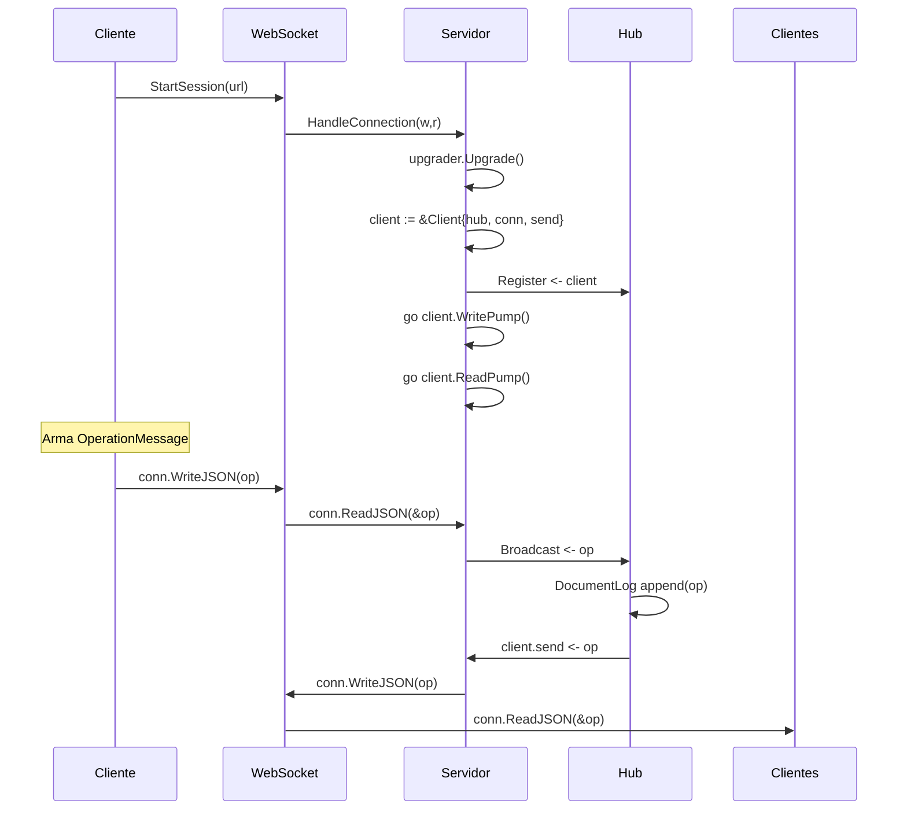

# Flujo de datos al enviar un mensaje

Este documento describe el flujo de datos cuando el cliente envia una operacion
al servidor y este la distribuye a todos los clientes conectados. El flujo
esta basado en las funciones reales del codigo.

## Diagrama ASCII (funciones reales)

```text
CLIENTE (internal/client/ws_client.go)          SERVIDOR (internal/server/*)                 CLIENTES
------------------------------------            ----------------------------                 --------
StartSession(url)
  |
  |-- websocket.DefaultDialer.Dial(url)
  |   (abre WS)
  |
  |-- goroutine: conn.ReadJSON(&op)
  |     recibe broadcast del servidor
  |
  |-- bucle stdin -> arma OperationMessage
  |     op := protocol.OperationMessage{Op: Insert, Position: 0, Content: "..."}
  |
  |-- conn.WriteJSON(op)  -------------------->  HandleConnection(w,r)
                                                   |
                                                   |-- upgrader.Upgrade(...)
                                                   |-- client := &Client{hub, conn, send}
                                                   |-- hub.Register <- client
                                                   |-- go client.WritePump()
                                                   |-- go client.ReadPump()
                                                           |
                                                           |-- conn.ReadJSON(&op)
                                                           |-- hub.Broadcast <- op
                                                           |
                                                Hub.Run()
                                                   |
                                                   |-- case op := <-Broadcast:
                                                   |     DocumentLog append(op)
                                                   |     for client := range clients:
                                                   |         client.send <- op
                                                   |
                                                Client.WritePump()
                                                   |
                                                   |-- op := <-c.send
                                                   |-- conn.WriteJSON(op)  -------------------->  todos los clientes reciben
                                                                                                 conn.ReadJSON(&op)
                                                                                                 print en consola
```

## Diagrama Mermaid (sequence)



## Referencias de codigo

- `internal/client/ws_client.go:14`
- `internal/server/socket.go:17`
- `internal/server/client.go:15`
- `internal/server/hub.go:25`
- `internal/protocol/messages.go:51`
