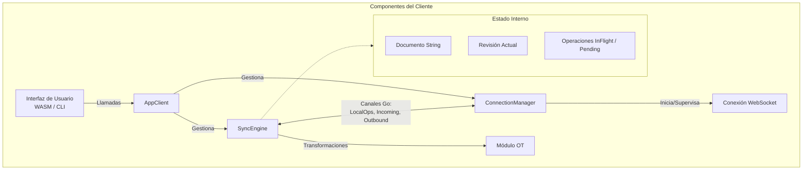
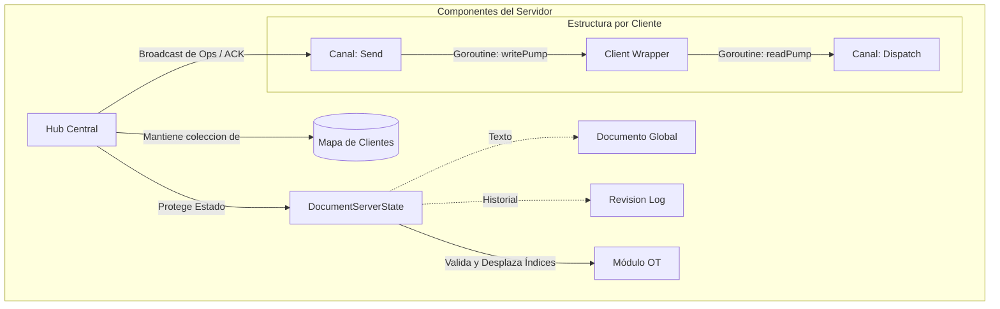
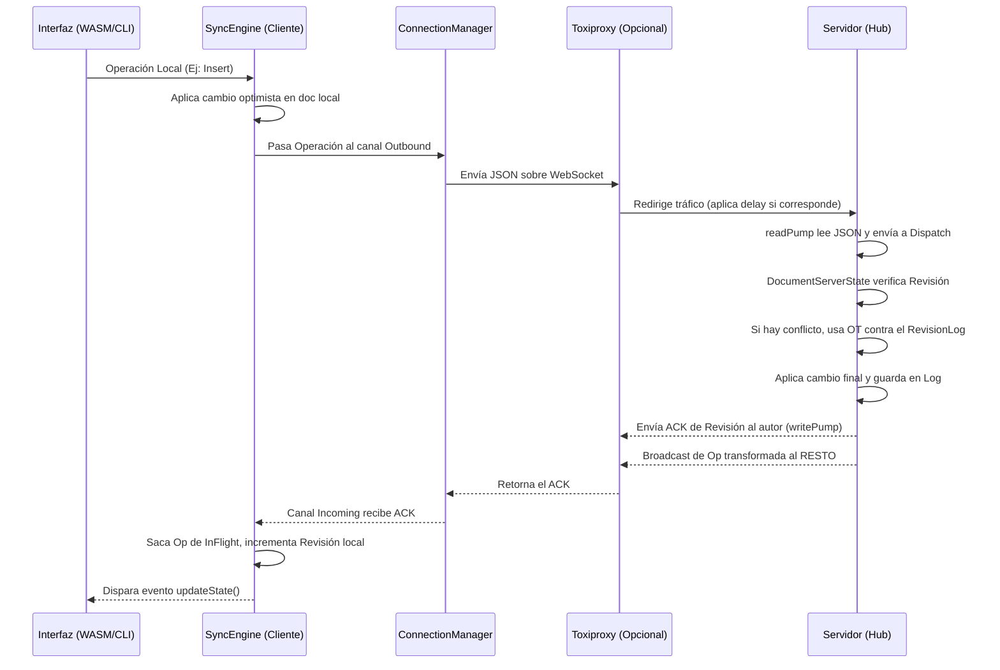
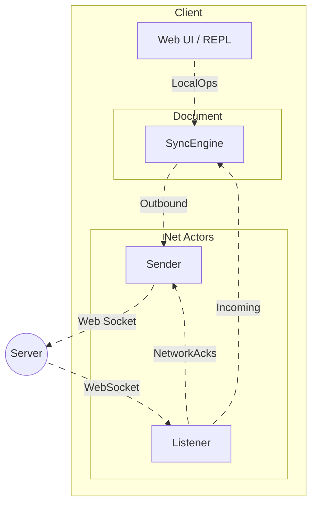

# Diagramas de Arquitectura (Mermaid)

A continuación se detallan los diagramas solicitados para comprender la estructura interna del cliente, del servidor y cómo se comunican entre sí.

## 1. Estructura del Cliente

El cliente está desacoplado de la interfaz gráfica (funciona tanto para WASM en el navegador como para la terminal) a través de un orquestador principal llamado `AppClient`. Este orquestador coordina el motor de sincronización (`SyncEngine`) y el gestor de red (`ConnectionManager`).

## 2. Estructura del Servidor

El servidor está diseñado alrededor de un **Hub** concurrente que gestiona múltiples clientes WebSocket, validando cada operación recibida contra el estado único de la verdad mantenido por `DocumentServerState`.

## 3. Flujo de Conexión y Comunicación (Cliente - Servidor)

El siguiente diagrama de secuencia muestra el camino completo que recorre una operación desde que el usuario tipea una tecla hasta que el servidor la confirma, pasando opcionalmente por Toxiproxy para simular las condiciones de red adversas.

### Flujo de Datos

