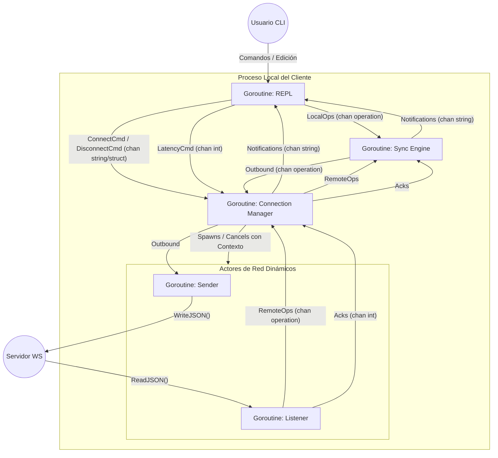
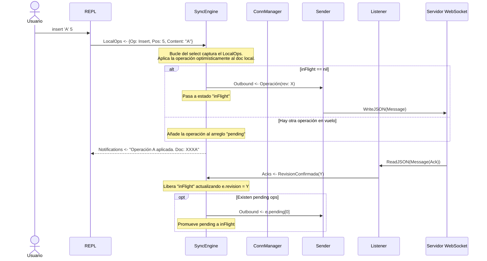

# Refactorización a Modelo de Actores (CSP)

Este documento detalla los cambios arquitectónicos realizados en el cliente para migrar hacia un diseño basado en el patrón **Actor Model (Event Loop)**, adoptando la filosofía de concurrencia CSP (Communicating Sequential Processes) de Go: *"No te comuniques compartiendo memoria; comparte memoria comunicándote"*.

## 1. Problemas de la Arquitectura Original

La implementación previa sufría de varios anti-patrones que comprometían su estabilidad y escalabilidad:
1. **Acoplamiento de Estado y Mutexes**: El estado compartido en `internal/client/repl/state.go` requería bloqueos constantes con `sync.RWMutex`, exponiendo el programa a bloqueos en cadena (deadlocks) o condiciones de carrera si los locks se omitían accidentalmente.
2. **Infracción de Concurrencia en WebSockets**: Se podía dar el caso de múltiples lecturas/escrituras al mismo `*websocket.Conn` desde múltiples lugares, lo que viola explícitamente el contrato de `gorilla/websocket` (solo admite un hilo lector y un hilo escritor concurrente).
3. **Plano de Control vs Datos Acoplados**: La conexión a red, el REPL, y la lógica de sincronización (Transformación Operacional) residían juntas o muy acopladas entre bucles sin contextos manejables, complicando el ciclo de vida, apagado, y desconexiones limpias.

## 2. ¿Qué cambiamos?

La nueva arquitectura puramente reactiva se ha dividido en **5 componentes autónomos**, cada uno de los cuales corre en su propia goroutine y carece de acceso directo al estado de los demás. La sincronización se delega enteramente a **Canales (`chan`)** y eventos manejados atómicamente a través de sentencias `select`.

### Componentes Creados/Modificados:

1. **`SyncEngine` (El Motor Central / Plano de Datos)**
   - **Archivo**: `internal/client/sync_engine.go`
   - Se encarga del dominio: la aplicación optimista de ediciones en el texto local y la **Transformación Operacional** (`operation.Transform`) ante los conflictos.
   - **Estado Privado**: Controla el `document`, la `revision`, las operaciones `pending` y la `inFlight`. Ningún otro componente puede acceder o mutar estas variables directamente.

2. **`ConnectionManager` (Supervisor / Plano de Control)**
   - **Archivo**: `internal/client/connection_manager.go`
   - Escucha órdenes para establecer la conexión al servidor. 
   - Utiliza `context.WithCancel(ctx)` de forma local para iniciar/terminar dinámicamente las goroutines de Red en el instante en el que una conexión se cierra, asegurando que no queden goroutines huérfanas o conexiones vivas indeseadas ("graceful shutdown").

3. **`Sender` y `Listener` (I/O Red - Actores)**
   - **Archivo**: `internal/client/net_actors.go`
   - **`Sender`**: Exclusivo para escritura (`WriteJSON`). Mantiene en todo momento la regla de single-writer. Implementa el inyector de latencia artificial retrasando el envío por la red.
   - **`Listener`**: Exclusivo para lectura (`ReadJSON`). Extrae y pre-valida el `seqNum` y lo enruta hacia los canales internos de datos del `SyncEngine`.

4. **`REPL` (Interfaz de Entrada)**
   - **Archivo**: `internal/client/repl/repl.go`
   - Adaptado a despachar eventos asincrónicos hacia canales (p. ej. `LocalOps` para inserciones, o `ConnectCmd` para URI's) en lugar de invocar métodos bloquentes.
   - Dispone de una sub-rutina en background, `notificationServer`, que espera de un canal para imprimir alertas sin interrumpir a `readline`.
   - Se eliminó `state.go` y `command.go`.

5. **`Message` envoltorio (Protocolo)**
   - **Archivo**: `internal/protocol/message/message.go`
   - Extendida con los campos `SeqNum` y `Revision` para enriquecer la trazabilidad por los Actores de Red (Listener verifica si la secuencia viene desencajada).

## 3. Flujo de Ejecución y Arquitectura de Datos

A continuación podemos observar la topología de la comunicación por canales entre las Goroutines. 

### Arquitectura de Canales (Componentes)

### Ciclo de Vida: Emisión de una Operación

Cuando un usuario decide hacer una edición (Ej: `insert A 5`), ocurre la siguiente secuencia atómica:

### ¿Por qué este modelo es superior?

1. **Previsibilidad y Atomización**: Dado que las goroutines iteran de un evento de canal en un evento de canal a través del `select`, procesan un paquete entero por vez, impidiendo que el motor reciba un ack en simultáneo mientras el REPL inyecta una tecla, o el listener inyecta un broadcast. Es imposible tener colisiones de escritura.
2. **Ciclo de vida limpio**: En Go puro (`goroutines + channels`), si el `context` cae (al hacer `disconnect`), el contexto propagado anula la espera en los Actores de red finalizándolos suavemente.
3. **Mantenibilidad Funcional**: `Transform()` ahora asume que el arreglo pending es privado y único al bucle; no hay que encapsular iteraciones complejas entre Mutexes, reduciendo el overhead cognitivo.
