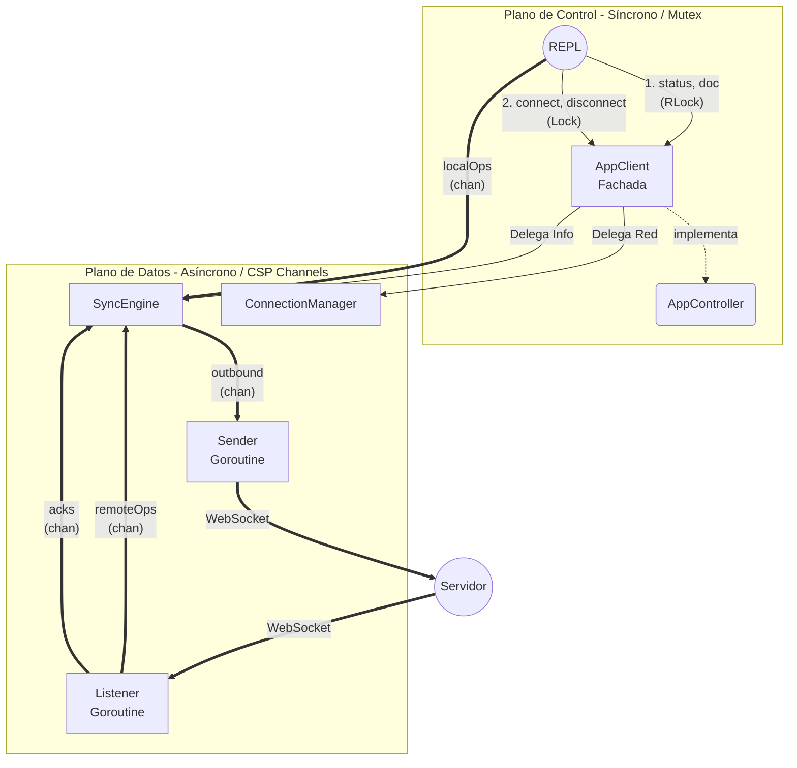
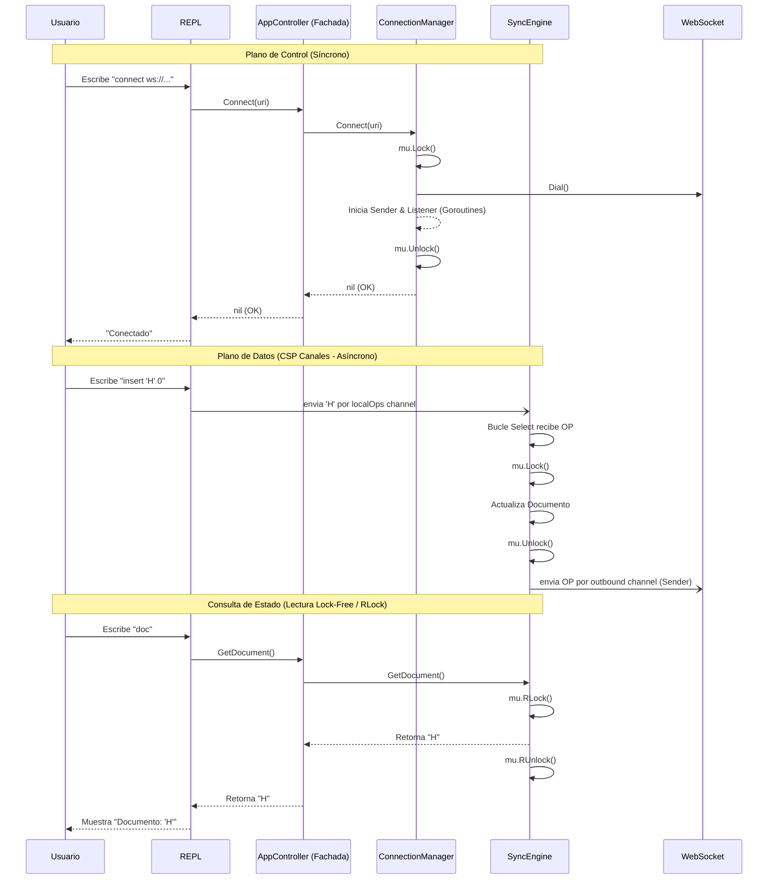

# Resumen de la Refactorización: Arquitectura Híbrida del Cliente

## 1. El Problema: "Channel Explosion"
En la arquitectura inicial del cliente, todos los componentes (REPL, SyncEngine, ConnectionManager) se comunicaban de forma exclusiva a través de canales (CSP - Communicating Sequential Processes). Esto provocaba un antipatrón conocido como **Channel Explosion**, donde:
- Operaciones críticas y de alta frecuencia (sincronización de documentos, envío de datos) compartían los mismos cuellos de botella y complejidad que los comandos simples (conectar, desconectar, consultar latencia).
- El ruteo de información estática (como consultas del estado del documento) a través de un canal requería un diseño asíncrono innecesario, complicando el código y ralentizando tareas que simplemente requerían acceso de solo lectura.

## 2. La Solución: Arquitectura Híbrida
Para solventar esto, aplicamos una **Arquitectura Híbrida** separando el sistema en dos planos bien definidos:

### A. Plano de Datos (Alta Frecuencia)
Se mantiene **exclusivamente mediante canales (CSP)** sin cerrojos. Es el encargado de la sincronización operativa pesada.
- **Flujos involucrados:** `localOps`, `remoteOps`, `acks`, y el canal de `outbound`.
- **Por qué:** Los canales son ideales para procesos concurrentes donde los datos (las ediciones de texto) fluyen continuamente y deben procesarse uno a uno en un bucle de eventos estricto (como el `select` de `SyncEngine`).

### B. Plano de Control (Baja Frecuencia / Consultas)
Se migró al uso de **Interfaces y Métodos públicos protegidos internamente con Mutex (`sync.RWMutex`)**.
- **Flujos involucrados:** Comandos del usuario como `connect`, `disconnect`, consultas de estado (`status`, `doc`), y manipulación de latencia (`latency`).
- **Por qué:** Permite un acceso síncrono rápido y seguro para el usuario desde el REPL o la UI, evitando encolar o bloquear operaciones de red y sincronización.

## 3. ¿Qué Cambiamos Exactamente?

1. **Definición de Interfaces (Contratos):**
   Creamos `interfaces.go` centralizando los permisos de control en cuatro contratos:
   - `ConnectionController`: `Connect`, `Disconnect`, `IsConnected`.
   - `NetworkSimulator`: `SetLatency`, `GetLatency`.
   - `DocumentInspector`: `GetDocument`, `GetRevision`, `GetPendingCount`, `HasInFlight`.
   - `AppController`: Fachada unificada (compone las interfaces anteriores).

2. **Refactor del `SyncEngine`:**
   - **Mantenido:** El bucle `for { select }` consumiendo operaciones.
   - **Añadido:** Un `sync.RWMutex`.
   - **Ajuste:** Ahora las mutaciones locales (cuando llega un canal) se envuelven muy rápidamente en un `Lock()`. Los métodos de la interfaz `DocumentInspector` retornan copias de las variables usando `RLock()`.

3. **Refactor del `ConnectionManager`:**
   - **Eliminado:** Los canales de control (`connectCmd`, `disconnectCmd`, `latencyCmd`).
   - **Añadido:** Implementación de `ConnectionController` y `NetworkSimulator`. Ahora las acciones de conexión instancian directamente el `Sender` y `Listener` dentro del método seguro.

4. **I/O Actores (`Sender` y `Listener`):**
   - Ahora consumen dinámicamente el valor de la latencia mediante una consulta directa al mánager (`Manager.GetLatency()`), permitiendo pausar peticiones de red si se requiere simular retrasos.

5. **El REPL (Interfaz de Usuario):**
   - Se reescribió para inyectarle únicamente la interfaz `AppController` en lugar de una docena de canales. Los comandos se ejecutan llamando directamente a los métodos de la interfaz (`r.Ctrl.GetDocument()`, `r.Ctrl.Connect(uri)`, etc.).

---

## 4. Diagramas de Flujo y Arquitectura

### A. Estructura y Flujo de Datos

### B. Flujo de Ejecución del Cliente (Ejemplo)

## 5. Resumen del Impacto

- **Mantenibilidad:** El código es mucho más fácil de leer. El REPL ya no gestiona canales y actúa como un cliente tradicional consumiendo una API o Interfaz local.
- **Rendimiento:** Evitar la creación de eventos y canales para simples *getters* reduce la presión en el recolector de basura (*Garbage Collector*) y mejora la latencia de respuesta de la UI.
- **Escalabilidad:** Se preserva el procesamiento estricto `lock-free` en el `SyncEngine` que aplica Operational Transformations (OT). Esto asegura que no hay demoras si miles de operaciones entraran simultáneamente mientras el REPL simplemente consulta el estado.
