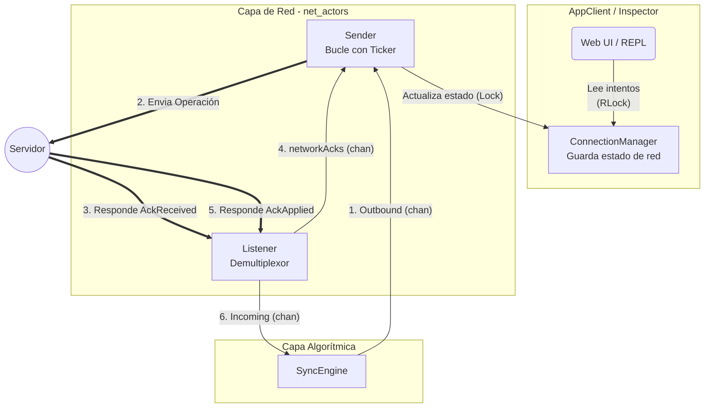
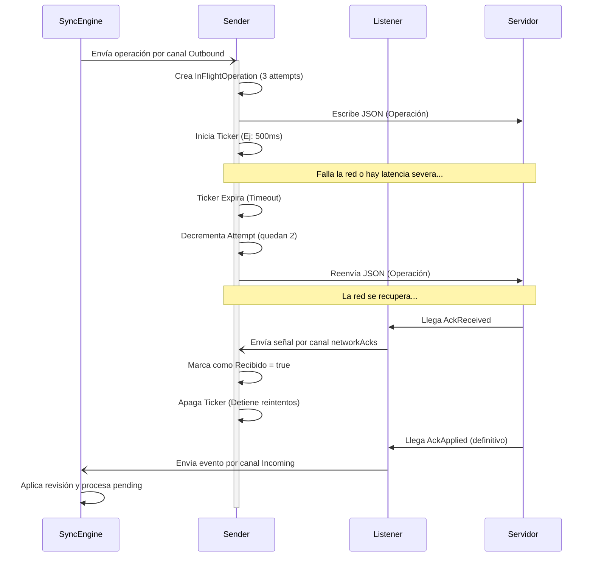

# Resumen: Refactorización de Reintentos de Red y Purificación del SyncEngine

## 1. El Problema: Acoplamiento de Red en la Lógica de OT
Inicialmente, la estructura `InFlightOperation` (que contiene campos puramente de red como `attempts` y `received`) se encontraba integrada dentro del `SyncEngine`.
Esto violaba el Principio de Responsabilidad Única (SRP) y nuestra Arquitectura Híbrida porque:
- Mezclaba la lógica matemática de Transformación Operacional (OT) con la lógica de transporte (reintentos, timeouts).
- Obligaba al `SyncEngine` a tener que gestionar temporizadores, ensuciando su bucle rápido de procesamiento de eventos.

## 2. La Solución: Delegación a Actores de Red (CSP)
Decidimos que la responsabilidad de reintentar el envío de un paquete perdido o demorado debe recaer estrictamente sobre la capa de I/O (los actores de red).

Para lograr esto sin romper el modelo asíncrono (CSP):
1. Se movió `InFlightOperation` al dominio de la red (`net_actors.go`).
2. Se introdujo un **Canal Dedicado (`networkAcks`)** exclusivo para la comunicación interna entre el `Listener` y el `Sender`.

## 3. Cambios Implementados

1. **Purificación del `SyncEngine`:**
   - Volvió a almacenar simplemente un puntero a `operation.Operation`. Su única responsabilidad respecto a la operación "en vuelo" es utilizarla para transformar operaciones remotas entrantes hasta que llegue el `AckApplied`.

2. **El `Listener` como Demultiplexor:**
   - Actúa como un enrutador inteligente. Al leer el socket, hace un `switch` del tipo de mensaje. Si es una `Operation` o un `AckApplied`, los manda al canal entrante del motor. Si es un `AckReceived` preliminar, lo desvía inmediatamente al canal `networkAcks` hacia el `Sender`.

3. **El `Sender` como Gestor de Reintentos:**
   - Su bucle `select` ahora maneja un `time.Ticker`.
   - Cuando despacha una operación, arranca el temporizador.
   - Si recibe señal por `networkAcks`, cancela el temporizador (el paquete llegó al servidor).
   - Si expira el temporizador (`<-ticker.C`), resta un intento (`attempt`) y reenvía. Si se agotan los intentos, aborta.

4. **Estado de Red Inspeccionable (UI) con Concurrencia Encapsulada:**
   - La estructura `InFlightOperation` encapsula su propia concurrencia usando un `sync.RWMutex`.
   - El `ConnectionManager` mantiene un único puntero centralizado `inFlightOp *InFlightOperation` en lugar de variables sueltas.
   - El `Sender` modifica el estado interno usando `Lock()` (ej. `DecrementAttempt()`), mientras que la Web UI / REPL leen simultáneamente los valores a través del Manager con `RLock()` (ej. `Attempts()`), logrando seguridad frente a Data Races sin inflar el Manager con código redundante.

5. **Propagación de Errores Nativos en Goroutines:**
   - El método `writeToSocket` ahora devuelve un `error` en caso de fallar la escritura en el WebSocket.
   - En lugar de cerrar la conexión a bajo nivel, `Sender.Run` hace un `return err`.
   - Esto permite que la goroutine se detenga limpiamente y que el `ConnectionManager` padre capture el error, cierre la conexión y notifique a la UI en un solo lugar.

---

## 4. Diagramas de Arquitectura y Flujo

### A. Estructura y Flujo de Datos (Plano de Datos)

### B. Flujo de Ejecución (Secuencia de un Reintento)

