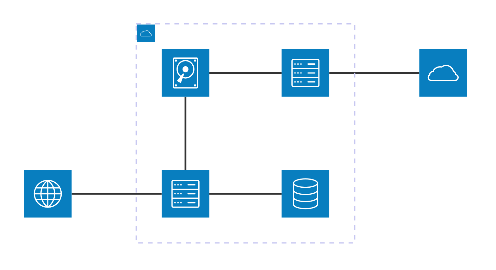
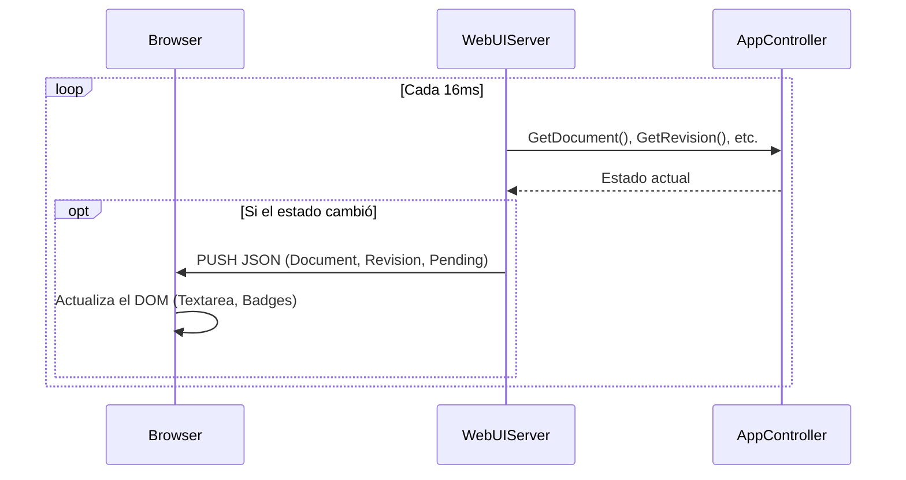
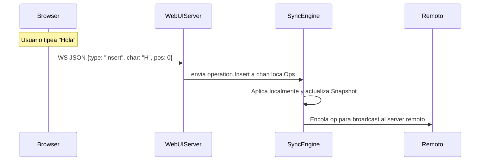

# Integración de la Web UI al Cliente Colaborativo en Go

Este documento detalla la transición de un cliente de terminal (REPL) hacia una arquitectura basada en un puente local (Local Bridge) Web, sin modificar las piezas centrales del motor de sincronización.

## 1. Motivación y Objetivos (El Porqué)

El cliente original utilizaba un REPL (Read-Eval-Print Loop) por terminal para recibir las pulsaciones de teclado del usuario y visualizar el estado del documento. Aunque funcional, la terminal limitaba la experiencia de usuario (UX) para un editor de texto colaborativo.

El objetivo fue **reemplazar o complementar la interfaz de terminal por una Interfaz Web** que el usuario corre localmente en su navegador, manteniendo la arquitectura _lock-free_ del motor Go en segundo plano. Esto asegura:
- Una experiencia gráfica _premium_.
- Un desacoplamiento total: la lógica fuerte (SyncEngine, OT/CRDTs, ConnectionManager) sigue en Go.
- El navegador actúa como un simple **"Dumb Client"**.

## 2. Cambios Realizados (El Qué)

No se modificó ni una sola línea de lógica en `sync_engine.go` o `connection_manager.go`. Se introdujo una adaptación transparente de las interfaces existentes.

**Archivos Creados:**
1. `web_ui/server.go`: El actor adaptador. Levanta un servidor HTTP (en un puerto configurable) y un WebSocket local (`/ws`).
2. `web_ui/index.html`: La interfaz gráfica de usuario en HTML/JS puro usando TailwindCSS.
3. `cli/client/cmd/start_web.go`: Nuevo comando `start-web` que actúa como homólogo del comando `start` (el cual usa el REPL), pero en su lugar levanta la capa HTTP para servir la Web UI. 

**Archivos Modificados:**
1. `cli/client/cmd/root.go`: Se registró el nuevo comando `newStartWebCmd()`.

## 3. Arquitectura del Puente Local (Local Bridge)

El servidor del `start-web` en Go ahora cumple un doble rol: es el cliente del servidor remoto de sincronización, y a la vez es un servidor web local para la interfaz gráfica del usuario.

## 4. Flujo de Datos

El diseño utiliza canales para los comandos ascendentes (escritura) y referencias atómicas (`atomic.Pointer`) para los estados descendentes (lectura).

### 4.1. Push de Estado (Go -> JS)
El `WebUIServer` tiene una goroutine (`pushLoop`) que se ejecuta a ~60 frames por segundo (16ms). Lee el estado del `AppController` de manera concurrente (sin locks) y, si detecta diferencias con el frame anterior, le hace push del JSON actualizado al navegador web mediante el WebSocket local.

### 4.2. Flujo de Operaciones (JS -> Go -> Servidor Remoto)
El HTML `index.html` capta los eventos `input` del `<textarea>`. Genera un *diff* rápido entre el estado anterior y el actual para discernir cuántos caracteres se insertaron o borraron. Se envían comandos JSON ligeros al `WebUIServer`. 

## 5. Flujo de Ejecución (El Arranque)

La arquitectura permite ejecutar simultáneamente clientes REPL y clientes Web, todos interactuando sobre el mismo documento maestro en el servidor remoto.

1. **Servidor Maestro**: Se levanta con `go run ./cli/server start`.
2. **Cliente REPL**: Se levanta con `go run ./cli/client start`. Usa la consola interactiva.
3. **Cliente Web UI**: Se levanta con `go run ./cli/client start-web --port <PUERTO>`.

Al ejecutar el cliente Web, el flujo principal orquesta el puente:

1. Se instancian los canales locales (`localOps`, `remoteOps`, `acks`, `notifications`).
2. Se instancia el `SyncEngine` y el `ConnectionManager`.
3. Se crea el `AppClient` que oficia de fachada (reuniendo lectura de estado y control de red).
4. Se crea el `WebUIServer` pasándole el `localOps`, el `AppClient` y el `--port` deseado (default 3000).
5. Se levanta el `SyncEngine` como goroutine.
6. Se inicia y bloquea el hilo principal sirviendo la Web UI (HTTP en el puerto elegido y WebSocket local `/ws`).
7. El usuario abre el navegador (ej: `localhost:3000`), se conecta automáticamente al puente local.
8. El usuario introduce la URI del servidor remoto (`ws://localhost:8080/ws`) y aprieta "Connect", lanzando los flujos de `pushLoop` y `readLoop`.

Al poder configurar el `--port`, se pueden ejecutar ilimitados puentes locales (clientes web) concurrentes en la misma máquina.
